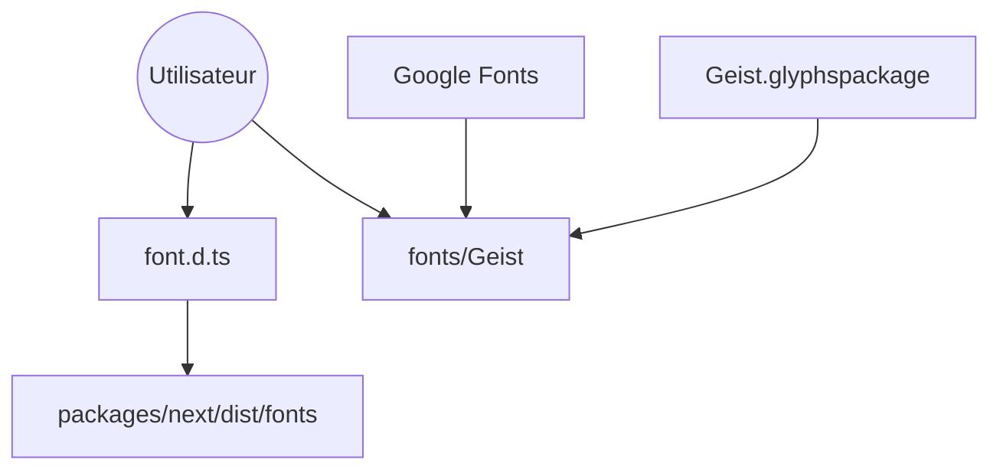

# vercel/geist-font

> Vercel's Geist font family (Sans, Mono, Pixel, Serif), for designers and interface developers.

## The problem
A product without consistent typography, readable in code as well as in headings, quickly looks sloppy.

## What it actually does
- Four families: Sans, Mono (code and terminal), Pixel and display Serif.
- Install from the releases, via npm or via Google Fonts (except Serif).
- One npm entry point per variant, so you only ship the files you import.
- Glyph sources provided and build via `make`.

## How it is wired


## Trying it
```bash
npm i geist
make build
make test
make proof
```

## Cost and gotchas
Free, OFL-1.1 license. The npm package targets Next.js; Geist Serif is not yet on Google Fonts.

## What it is not
Not a code library: font files. Loading on the Next.js side is not detailed in the README.

## Alternatives
No alternative named in the README (Inter, Univers, SF Mono are cited as inspirations).

## For you
Ignore on the data / AI side: only useful for dressing up a dashboard or an interface.
