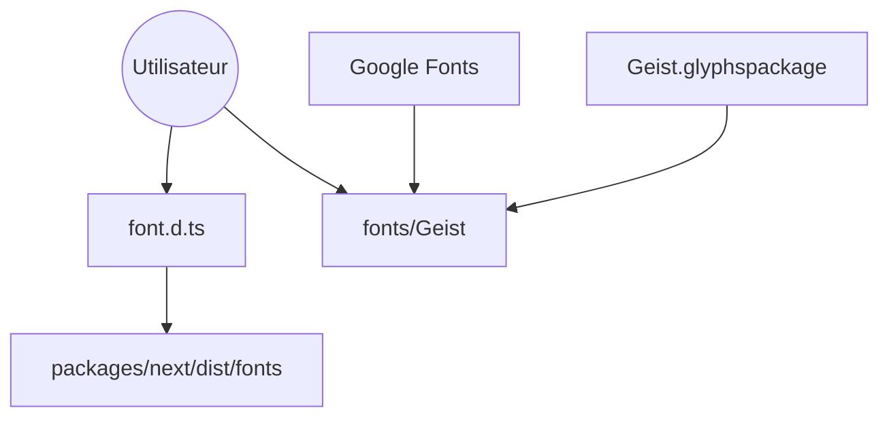

# vercel/geist-font

> Famille de polices Geist (Sans, Mono, Pixel, Serif) de Vercel, pour designers et développeurs d'interfaces.

## Le problème
Un produit sans typographie cohérente, lisible en code comme en titre, paraît vite brouillon.

## Ce que ça fait vraiment
- Quatre familles : Sans, Mono (code et terminal), Pixel et Serif d'affichage.
- Installation depuis les releases, via npm ou via Google Fonts (sauf Serif).
- Entrées npm par variante, pour n'embarquer que les fichiers importés.
- Sources de glyphes fournies et build par `make`.

## Comment c'est branché


## Essayer
```bash
npm i geist
make build
make test
make proof
```

## Coût et pièges
Gratuit, licence OFL-1.1. Le paquet npm cible Next.js ; Geist Serif n'est pas encore sur Google Fonts.

## Ce que ce n'est pas
Pas une bibliothèque de code : des fichiers de polices. Le chargement côté Next.js n'est pas détaillé dans le README.

## Alternatives
Aucune alternative nommée dans le README (Inter, Univers, SF Mono sont cités comme inspirations).

## Pour toi
À ignorer côté data / IA : utile seulement pour habiller un tableau de bord ou une interface.

