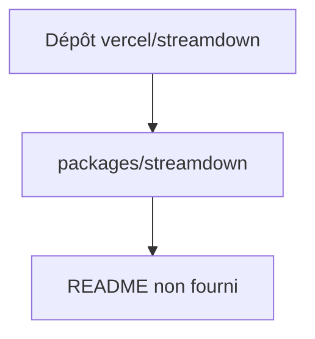

# vercel/streamdown

> Streaming Markdown rendering component, according to its README path; insufficient material to say more.

## The problem
Not documented: the supplied README contains only the path `packages/streamdown/README.md`.

## What it actually does
Not documented. The README content was not supplied, only a path reference was read.

## How it is wired
Simplified diagram based on the sheet, no diagram provided.

## Trying it
No command documented in the supplied material.

## Cost and gotchas
Not documented. License present but not identified by GitHub.

## What it is not
Minimal sheet: nothing allows asserting what the project does beyond its name. The nature and deployment indicated are weak hypotheses.

## Alternatives
No alternative named in the README.

## For you
Watch by default: impossible to decide without a README, you need to read the repository before deciding.
