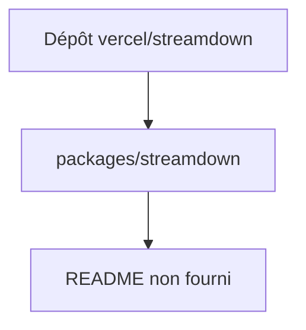

# vercel/streamdown

> Composant de rendu Markdown en flux, selon son chemin README ; matière insuffisante pour en dire plus.

## Le problème
Non documenté : le README fourni ne contient que le chemin `packages/streamdown/README.md`.

## Ce que ça fait vraiment
Non documenté. Le contenu du README n'a pas été fourni, seule une référence de chemin a été lue.

## Comment c'est branché
Schéma simplifié d'après la fiche, sans diagramme fourni.

## Essayer
Aucune commande documentée dans la matière fournie.

## Coût et pièges
Non documenté. Licence présente mais non identifiée par GitHub.

## Ce que ce n'est pas
Fiche minimale : rien ne permet d'affirmer ce que fait le projet au-delà de son nom. La nature et le déploiement indiqués sont des hypothèses faibles.

## Alternatives
Aucune alternative nommée dans le README.

## Pour toi
À surveiller par défaut : impossible de trancher sans README, il faut lire le dépôt avant de décider.

