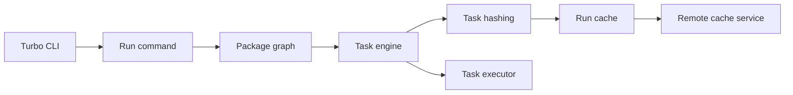

# vercel/turborepo

> Build system with caching for JavaScript and TypeScript monorepos, for web teams.

## The problem
In a monorepo, rebuilding and retesting every package on every change wastes a considerable amount of time.

## What it actually does
The README contains almost nothing: one sentence ("build system for coding agents") and links. From the Rust code: the `turbo` CLI discovers the repository, builds the package and task graph, computes hashes, caches results (local or remote), runs tasks with a terminal interface, and offers a file-watching daemon and a micro-frontends proxy.

## How it is wired

## Trying it
No commands in the README: it points to turborepo.dev.

## Cost and gotchas
Free; the remote cache goes through Vercel's service (a vendor offering, not detailed in the README).

## What it is not
Not a build tool for Python or data pipelines. The README's "for coding agents" mention is not explained.

## Alternatives
No alternative is cited in the README.

## For you
Ignore: aimed at JavaScript monorepos; your Python or MLOps projects would be better served by Make, DVC or Bazel.
