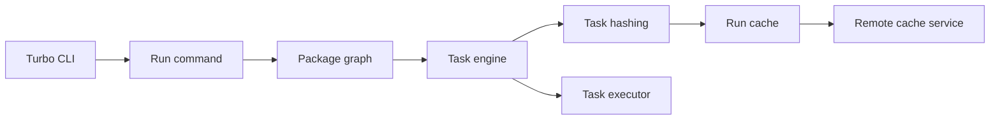

# vercel/turborepo

> Système de build avec cache pour monorepos JavaScript et TypeScript, pour équipes web.

## Le problème
Dans un monorepo, rebâtir et retester chaque paquet à chaque changement fait perdre un temps considérable.

## Ce que ça fait vraiment
Le README ne contient presque rien : une phrase (« build system for coding agents ») et des liens. D'après le code Rust : la CLI `turbo` découvre le dépôt, construit le graphe de paquets et de tâches, calcule des empreintes, met en cache les résultats (local ou distant), exécute les tâches avec une interface terminal, et propose un démon de surveillance de fichiers et un proxy de micro-frontends.

## Comment c'est branché

## Essayer
Aucune commande dans le README : renvoie vers turborepo.dev.

## Coût et pièges
Gratuit ; le cache distant passe par le service de Vercel (offre du fournisseur, non détaillée dans le README).

## Ce que ce n'est pas
Pas un outil de build pour Python ni pour pipelines de données. La mention « pour agents de code » du README n'est pas expliquée.

## Alternatives
Aucune alternative citée dans le README.

## Pour toi
À ignorer : orienté monorepos JavaScript ; tes projets Python ou MLOps seraient mieux servis par Make, DVC ou Bazel.

