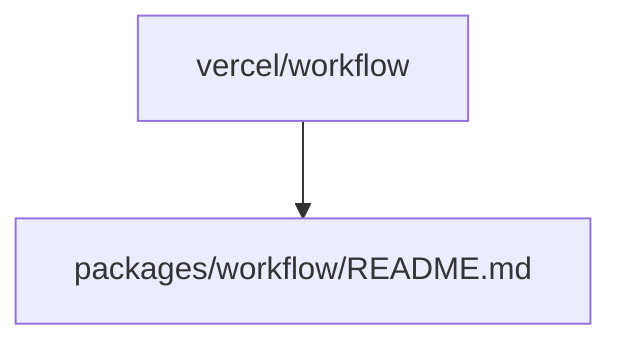

# vercel/workflow

> Vercel repository whose provided README boils down to a file path: undocumented function.

## The problem
Undocumented: the provided README contains only "packages/workflow/README.md".

## What it actually does
Undocumented. The name suggests a workflow tool, but nothing in the material provided allows us to say so.

## How it is wired
Simplified diagram based on the sheet, no diagram provided.

## Trying it
No documented command.

## Cost and gotchas
Undocumented. Apache-2.0 according to the catalog; 476 open issues.

## What it is not
Cannot be evaluated: the material is insufficient. Do not infer features from the name.

## Alternatives
No alternative named in the README.

## For you
Ignore for now: without a description, it is impossible to justify a data / AI use; revisit if the README is completed.
