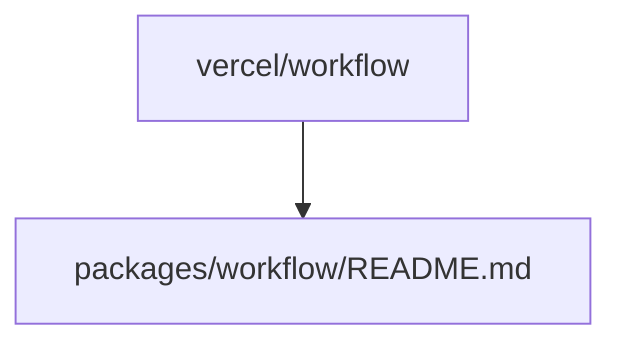

# vercel/workflow

> Dépôt de Vercel dont le README fourni se réduit à un chemin de fichier : fonction non documentée.

## Le problème
Non documenté : le README fourni ne contient que « packages/workflow/README.md ».

## Ce que ça fait vraiment
Non documenté. Le nom suggère un outil de workflows, mais rien dans la matière fournie ne permet de l'affirmer. 

## Comment c'est branché
Schéma simplifié d'après la fiche, sans diagramme fourni.

## Essayer
Aucune commande documentée.

## Coût et pièges
Non documenté. Apache-2.0 d'après le catalogue ; 476 issues ouvertes.

## Ce que ce n'est pas
Pas évaluable : la matière est insuffisante. Ne pas déduire de fonctions à partir du nom.

## Alternatives
Aucune alternative nommée dans le README.

## Pour toi
À ignorer pour l'instant : sans description, impossible de justifier un usage data / IA ; à relire si le README est complété.

