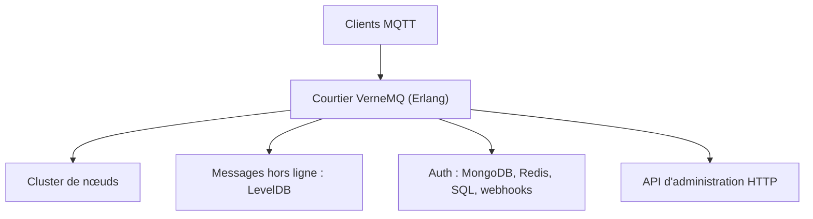

# vernemq/vernemq

> Distributed MQTT broker, written in Erlang, for highly concurrent IoT platforms.

## The problem
Thousands of connected devices need a message broker that scales horizontally and tolerates failures.

## What it actually does
Implements MQTT 3.1, 3.1.1 and 5.0 with QoS 0 to 2, TLS, WebSockets, clustering, shared subscriptions, bridges and multitenancy. Authentication and integration with MongoDB, Redis, MySQL, PostgreSQL and CockroachDB, HTTP webhooks, an administration API and session tracing. Offline storage via LevelDB.

## How it is wired
Simplified diagram based on the sheet, no diagram provided.



## Trying it
```bash
cd $VERNEMQ
make rel
cd $VERNEMQ/_build/default/rel/vernemq
bin/vernemq start
```
The status is then visible at `http://localhost:8888/status`.

## Cost and gotchas
Free. Built with Erlang/OTP 27 to 29, `libsnappy-dev` and a C compiler. Custom versions are offered to commercial customers.

## What it is not
Not a general-purpose message bus like Kafka: it only speaks MQTT. No ready-made Docker image in this README (it points to other Docker repositories).

## Alternatives
- No alternative named in the README.

## For you
Ignore unless you have an IoT project: a solid MQTT broker, but ingesting sensor data is not your core business.
