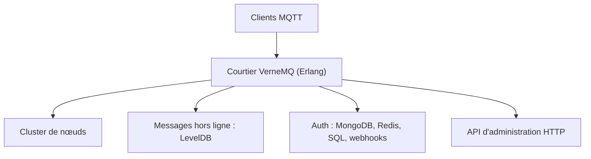

# vernemq/vernemq

> Courtier MQTT distribué, écrit en Erlang, pour plateformes IoT à forte concurrence.

## Le problème
Des milliers d'appareils connectés ont besoin d'un courtier de messages qui monte en charge horizontalement et tolère les pannes.

## Ce que ça fait vraiment
Implémente MQTT 3.1, 3.1.1 et 5.0 avec QoS 0 à 2, TLS, WebSockets, clustering, abonnements partagés, ponts et multitenance. Authentification et intégration avec MongoDB, Redis, MySQL, PostgreSQL et CockroachDB, webhooks HTTP, API d'administration et traçage de sessions. Stockage hors ligne via LevelDB.

## Comment c'est branché
Schéma simplifié d'après la fiche, sans diagramme fourni.



## Essayer
```bash
cd $VERNEMQ
make rel
cd $VERNEMQ/_build/default/rel/vernemq
bin/vernemq start
```
Le statut est ensuite visible sur `http://localhost:8888/status`.

## Coût et pièges
Gratuit. Compilation avec Erlang/OTP 27 à 29, `libsnappy-dev` et un compilateur C. Des versions personnalisées sont proposées aux clients commerciaux.

## Ce que ce n'est pas
Pas un bus de messages généraliste type Kafka : il ne parle que MQTT. Pas d'image Docker prête dans ce README (renvoi à d'autres dépôts Docker).

## Alternatives
- Aucune alternative nommée dans le README.

## Pour toi
À ignorer sauf projet IoT : un courtier MQTT solide, mais l'ingestion de données de capteurs n'est pas ton cœur de métier.

