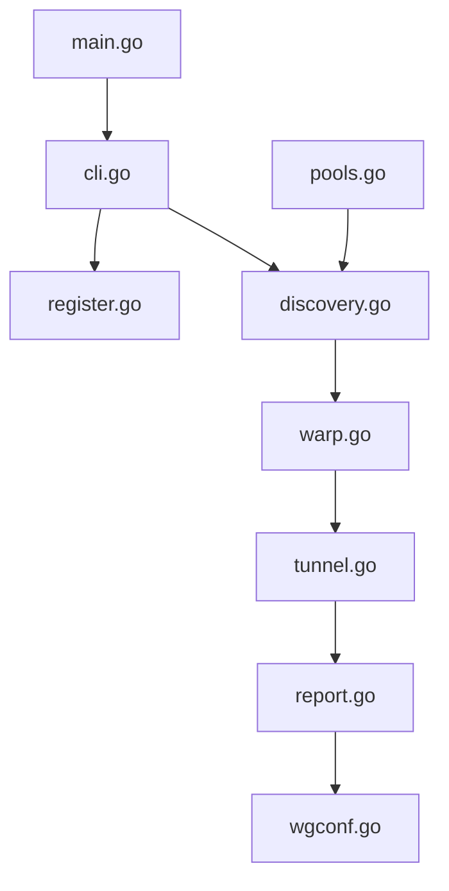

# vernette/warpscout

> Cloudflare WARP address scanner that picks the best exit point and writes an importable config.

## The problem
The official WARP client does not let you choose the Cloudflare node; some nodes are filtered by DPI and sites stop opening.

## What it actually does
Walks through the WARP subnet addresses, shows the exit node and region for each, measures latency and loss inside the tunnel, then writes a WireGuard or AmneziaWG config. It also offers MASQUE, a SOCKS5 proxy and a search for obfuscation parameters.

## How it is wired


## Trying it
```bash
curl -fsSL https://raw.githubusercontent.com/vernette/warpscout/master/install.sh | sh
warpscout register
warpscout scan -p awg -P -exclude-node DME -conf warp.conf
```

## Cost and gotchas
Free, but `register` creates a WARP account and a `warpscout-account.json` file. Depends on Cloudflare. A scan takes a few minutes.

## What it is not
Not a VPN: it produces a config to import into an AmneziaWG or WireGuard client. It guarantees nothing if the network filters everything.

## Alternatives
No alternative named in the README, apart from the credited projects that inspired it (puzige/CloudflareWarpSpeedTest, Diniboy1123/usque).

## For you
Ignore: network circumvention utility, unrelated to data, AI or MLOps work.
