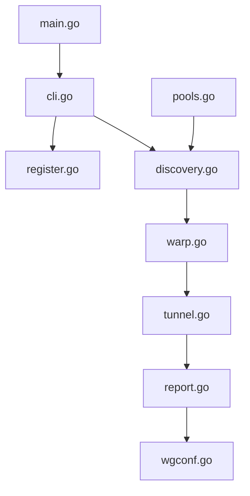

# vernette/warpscout

> Scanner d'adresses Cloudflare WARP qui choisit le meilleur point de sortie et écrit une config importable.

## Le problème
Le client WARP officiel ne laisse pas choisir le nœud Cloudflare ; certains nœuds sont filtrés par DPI et des sites ne s'ouvrent plus.

## Ce que ça fait vraiment
Parcourt les adresses des sous-réseaux WARP, affiche pour chacune le nœud et la région de sortie, mesure latence et perte dans le tunnel, puis écrit une config WireGuard ou AmneziaWG. Il propose aussi MASQUE, un proxy SOCKS5 et une recherche de paramètres d'obfuscation.

## Comment c'est branché


## Essayer
```bash
curl -fsSL https://raw.githubusercontent.com/vernette/warpscout/master/install.sh | sh
warpscout register
warpscout scan -p awg -P -exclude-node DME -conf warp.conf
```

## Coût et pièges
Gratuit, mais `register` crée un compte WARP et un fichier `warpscout-account.json`. Dépend de Cloudflare. Un scan prend quelques minutes.

## Ce que ce n'est pas
Pas un VPN : il produit une config à importer dans un client AmneziaWG ou WireGuard. Il ne garantit rien si le réseau filtre tout.

## Alternatives
Aucune alternative nommée dans le README, hors les projets crédités qui l'ont inspiré (puzige/CloudflareWarpSpeedTest, Diniboy1123/usque).

## Pour toi
À ignorer : utilitaire de contournement réseau, sans lien avec un travail data, IA ou MLOps.

