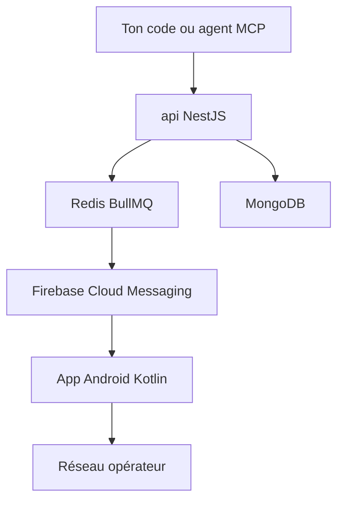

# vernu/textbee

> Open source SMS gateway that turns an Android phone into a REST API, webhooks and an MCP server.

## The problem
Sending SMS through an API costs a number subscription and per-message fees at Twilio and its equivalents, plus a registration procedure.

## What it actually does
Your code calls the API; the API pushes the message to the phone through Firebase Cloud Messaging, and the phone sends it through its SIM. Incoming SMS come back through the API, the dashboard or HMAC-SHA256 signed webhooks. There are JavaScript and Python SDKs, and an MCP server for agents.

## How it is wired
Simplified diagram based on the sheet, no diagram provided.


## Trying it
```bash
git clone https://github.com/textbee/textbee.git
cd textbee
cp api/.env.example api/.env
cp web/.env.example web/.env
docker compose up -d
```

## Cost and gotchas
Free hosted offer with paid plans; self-hosting has no plan limit but requires MongoDB, Redis, Firebase, SMTP, an HTTPS domain and an Android build. The phone must stay on; the carrier may limit sending.

## What it is not
Not compatible with iPhone. Not on the Play Store: you install an APK. SMS marketing is still subject to the law, which is your responsibility. AGPL-3.0 license: obligations apply if you offer a derived service.

## Alternatives
- Twilio: rented number and per-message fees, but no phone to maintain.

## For you
Ignore: useful for SMS alerts or an agent that writes by SMS, but it is not a data tool; the AGPL weighs on you if you embed it.
