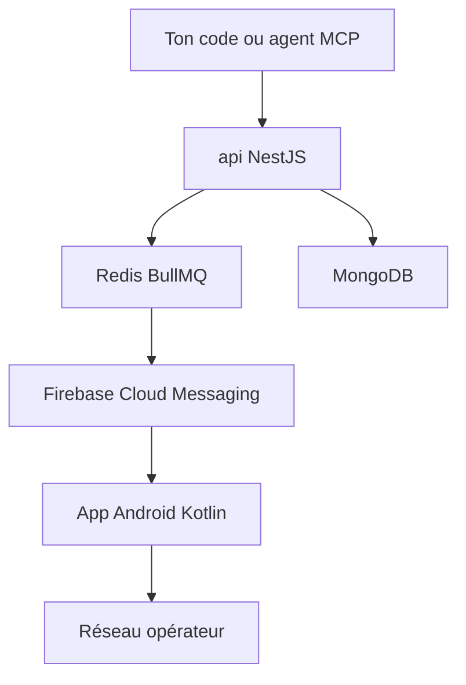

# vernu/textbee

> Passerelle SMS open source qui transforme un téléphone Android en API REST, webhooks et serveur MCP.

## Le problème
Envoyer des SMS par API coûte un abonnement de numéro et des frais par message chez Twilio et équivalents, avec une procédure d'enregistrement.

## Ce que ça fait vraiment
Ton code appelle l'API ; celle-ci pousse le message au téléphone via Firebase Cloud Messaging, et le téléphone l'envoie par sa SIM. Les SMS reçus remontent par l'API, le tableau de bord ou des webhooks signés HMAC-SHA256. Il y a des SDK JavaScript et Python, et un serveur MCP pour les agents.

## Comment c'est branché
Schéma simplifié d'après la fiche, sans diagramme fourni.


## Essayer
```bash
git clone https://github.com/textbee/textbee.git
cd textbee
cp api/.env.example api/.env
cp web/.env.example web/.env
docker compose up -d
```

## Coût et pièges
Offre hébergée gratuite avec plans payants ; l'auto-hébergement n'a pas de limite de plan mais demande MongoDB, Redis, Firebase, SMTP, un domaine HTTPS et un build Android. Le téléphone doit rester allumé ; l'opérateur peut limiter les envois.

## Ce que ce n'est pas
Pas compatible iPhone. Pas sur le Play Store : APK à installer. Le marketing par SMS reste soumis à la loi, c'est ta responsabilité. Licence AGPL-3.0 : obligations en cas de service dérivé.

## Alternatives
- Twilio : numéro loué et frais par message, mais sans téléphone à maintenir.

## Pour toi
À ignorer : utile pour des alertes SMS ou un agent qui écrit par SMS, mais ce n'est pas un outil data ; l'AGPL pèse si tu l'intègres.

