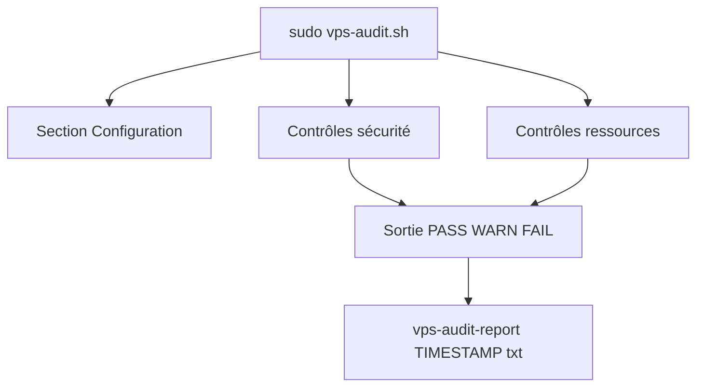

# vernu/vps-audit

> Bash script that audits the security and resources of a Debian or Ubuntu VPS and writes a report.

## The problem
A freshly installed VPS often has root SSH, no active firewall or open ports that nobody reviews.

## What it actually does
The script checks SSH (root, password, port), firewall (UFW, firewalld, iptables, nftables), Fail2ban or CrowdSec, login failures, updates, services, open ports, sudo, password policy and SUID files. It displays PASS, WARN, FAIL in color and writes a text report. Thresholds are set at the top of the script.

## How it is wired


## Trying it
```bash
wget https://raw.githubusercontent.com/Nuver-Labs/vps-audit/main/vps-audit.sh
chmod +x vps-audit.sh
sudo ./vps-audit.sh
```

## Cost and gotchas
Free, MIT. Requires root or sudo. Designed for Debian and Ubuntu only. The script reads system logs: review it before running it.

## What it is not
Not a professional audit: the README says so. Not a vulnerability or container scanner. Some checks need adapting to your environment.

## Alternatives
No alternative named in the README.

## For you
Worth watching: useful as a first check of a VPS hosting a model or a service, without replacing a real audit.
