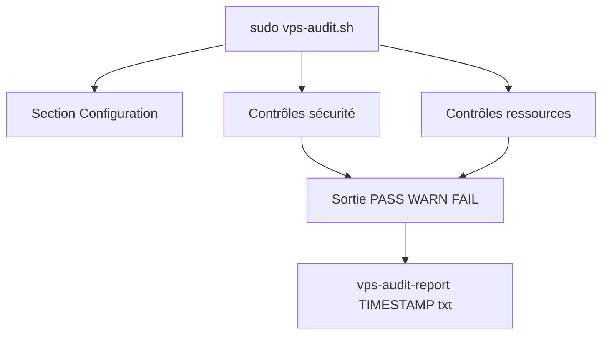

# vernu/vps-audit

> Script Bash qui audite la sécurité et les ressources d'un VPS Debian ou Ubuntu et écrit un rapport.

## Le problème
Un VPS fraîchement installé a souvent SSH en root, pas de pare-feu actif ou des ports ouverts que personne ne revoit.

## Ce que ça fait vraiment
Le script contrôle SSH (root, mot de passe, port), pare-feu (UFW, firewalld, iptables, nftables), Fail2ban ou CrowdSec, échecs de connexion, mises à jour, services, ports ouverts, sudo, politique de mot de passe et fichiers SUID. Il affiche PASS, WARN, FAIL en couleur et écrit un rapport texte. Les seuils se règlent en tête de script.

## Comment c'est branché


## Essayer
```bash
wget https://raw.githubusercontent.com/Nuver-Labs/vps-audit/main/vps-audit.sh
chmod +x vps-audit.sh
sudo ./vps-audit.sh
```

## Coût et pièges
Gratuit, MIT. Exige root ou sudo. Conçu pour Debian et Ubuntu seulement. Le script lit des journaux système : relis-le avant de l'exécuter.

## Ce que ce n'est pas
Pas un audit professionnel : le README le dit. Pas un scanner de vulnérabilités ni de conteneurs. Certains contrôles demandent une adaptation à ton environnement.

## Alternatives
Aucune alternative nommée dans le README.

## Pour toi
À surveiller : utile pour un premier contrôle d'un VPS qui héberge un modèle ou un service, sans remplacer un vrai audit.

