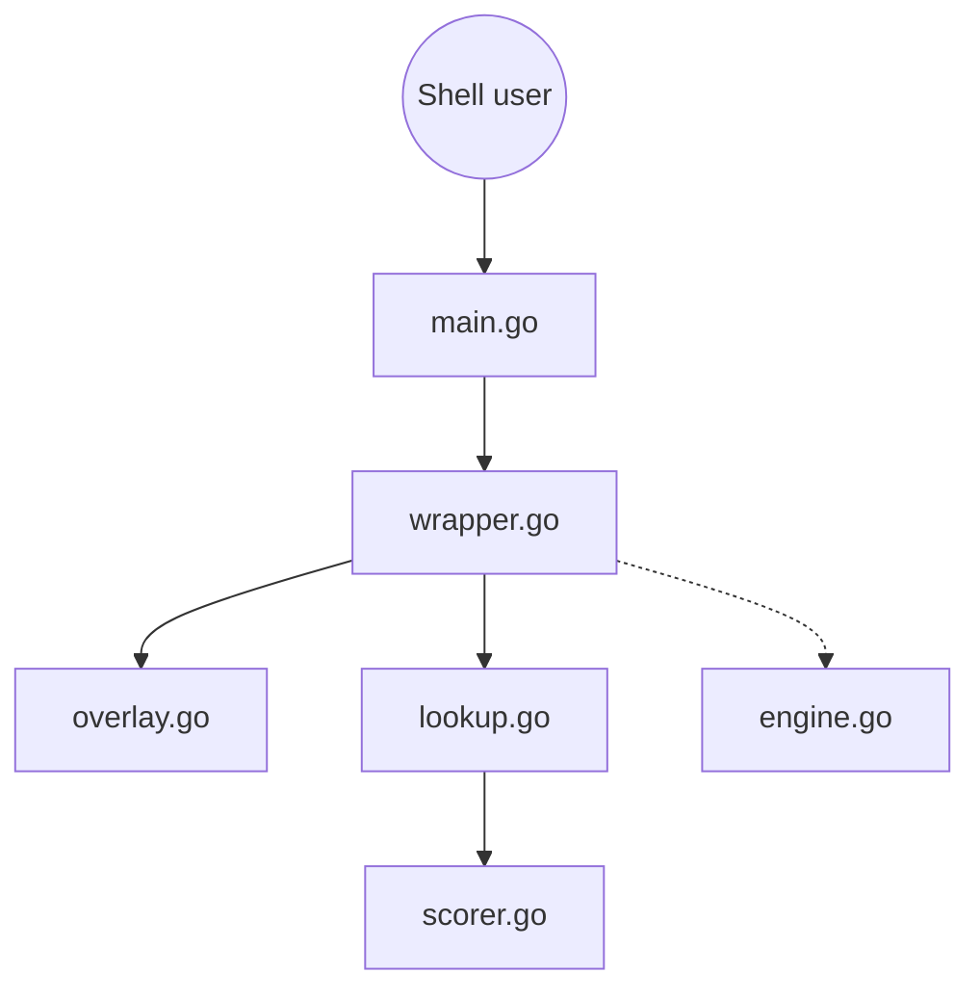

# versenilvis/IRIS

> Inline command autocompletion in the terminal, as a single Go binary, with no telemetry, successor to Fig.

## The problem
Fig was shut down in 2024 (README); autocompletion plugins depend on the shell and slow its startup, especially over SSH.

## What it actually does
A shell wrapper in Go: it tracks the command line, looks for suggestions in tool specs, argument generators, history and aliases, ranks them (scoring, workspace context) then displays them in an inline overlay. TOML configuration reloaded on the fly. Optional AI suggestions via Groq or Ollama, disabled by default.

## How it is wired


## Trying it
```bash
curl -sSL https://raw.githubusercontent.com/versenilvis/iris/main/scripts/install.sh | sh
eval "$(iris init zsh)"
iris config init
iris update
```

## Cost and gotchas
Free; Linux and macOS, not Windows. AI requires a Groq key (or local Ollama). Possible conflicts with zsh-autosuggestions, atuin, etc.: disable them. Debug mode logs everything you type.

## What it is not
Not a replacement for your shell nor for an encrypted history. One person maintains the project; the README claims zero telemetry, which has not been verified here.

## Alternatives
- Fig: discontinued, macOS only.
- zsh-autosuggestions, zsh-autocomplete: tied to the shell.
- atuin: history, can coexist via a setting.

## For you
Adopt on a trial basis: direct gain if you spend your time on SSH or in the terminal (servers, MLOps), permissive 0BSD license and recent activity.
