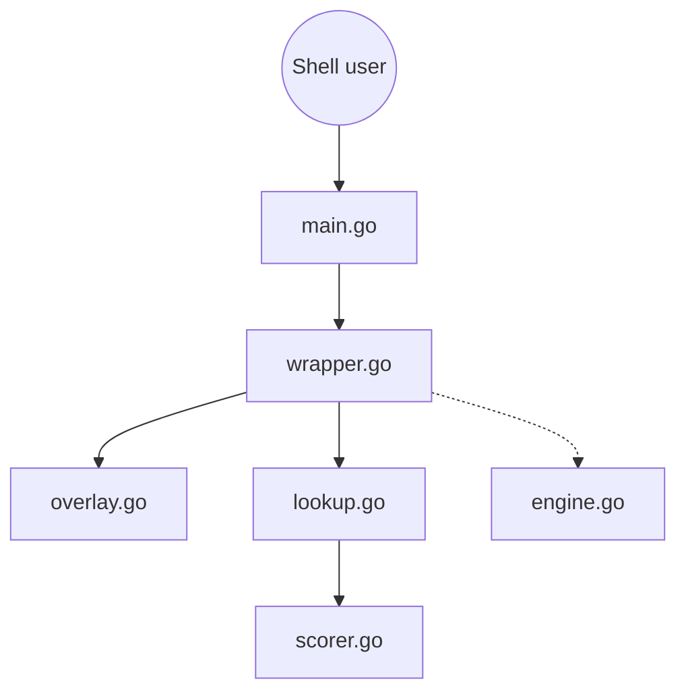

# versenilvis/IRIS

> Autocomplétion de commandes inline dans le terminal, en binaire Go unique, sans télémétrie, héritière de Fig.

## Le problème
Fig a été arrêté en 2024 (README) ; les plugins d'autocomplétion dépendent du shell et alourdissent son démarrage, surtout en SSH.

## Ce que ça fait vraiment
Un wrapper de shell en Go : il suit la ligne de commande, cherche des suggestions dans des specs d'outils, des générateurs d'arguments, l'historique et les alias, les classe (scoring, contexte du workspace) puis les affiche en overlay inline. Configuration TOML rechargée à chaud. Suggestions IA optionnelles via Groq ou Ollama, désactivées par défaut.

## Comment c'est branché


## Essayer
```bash
curl -sSL https://raw.githubusercontent.com/versenilvis/iris/main/scripts/install.sh | sh
eval "$(iris init zsh)"
iris config init
iris update
```

## Coût et pièges
Gratuit ; Linux et macOS, pas Windows. L'IA demande une clé Groq (ou Ollama local). Conflits possibles avec zsh-autosuggestions, atuin, etc. : à désactiver. Le mode debug journalise tout ce que tu tapes.

## Ce que ce n'est pas
Pas un remplaçant de ton shell ni d'un historique chiffré. Une personne maintient le projet ; le README annonce zéro télémétrie sans que cela soit vérifié ici.

## Alternatives
- Fig : arrêté, macOS seulement.
- zsh-autosuggestions, zsh-autocomplete : liés au shell.
- atuin : historique, peut cohabiter via un réglage.

## Pour toi
Adopter à l'essai : gain direct si tu passes ton temps en SSH ou en terminal (serveurs, MLOps), licence 0BSD permissive et activité récente.

