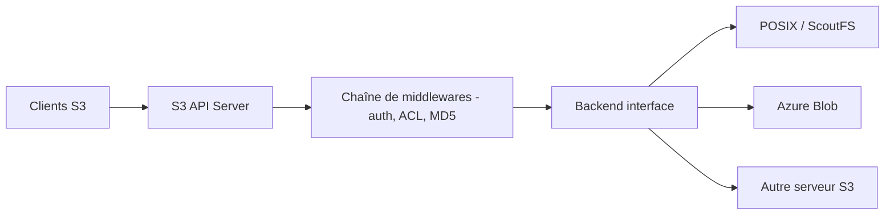

# versity/versitygw

> Stateless S3 gateway that exposes a POSIX file system or other storage as an S3 API.

## The problem
Applications speak S3 while the data lives on a file system or other storage.

## What it actually does
The server translates S3 requests to a backend: POSIX, ScoutFS, Azure Blob or another S3 server. It is stateless, so several instances can run behind a load balancer. It also provides a static website, an optional WebGUI, S3 over RDMA, events (Kafka, NATS, webhook) and StatsD metrics. The HTTP server is built on Fiber, compatibility on aws-sdk-go-v2.

## How it is wired


## Trying it
```bash
mkdir /tmp/vgw /tmp/vers
ROOT_ACCESS_KEY="testuser" ROOT_SECRET_KEY="secret" ./versitygw --port :10000 --iam-dir /tmp/vgw posix --versioning-dir /tmp/vers /tmp/vgw
docker run --rm versity/versitygw:latest --version
helm install versitygw oci://ghcr.io/versity/versitygw/charts/versitygw
```

## Cost and gotchas
Free; enterprise support from Versity (paid). The JSON `--iam-dir` is meant for testing, not for real access control.

## What it is not
It is not storage: it translates to an existing backend. The README's robustness claims come from the vendor, not from an independent measurement.

## Alternatives
No alternative named in the README.

## For you
Worth watching: interesting for exposing a file space as S3 to data pipelines without migrating the data.
