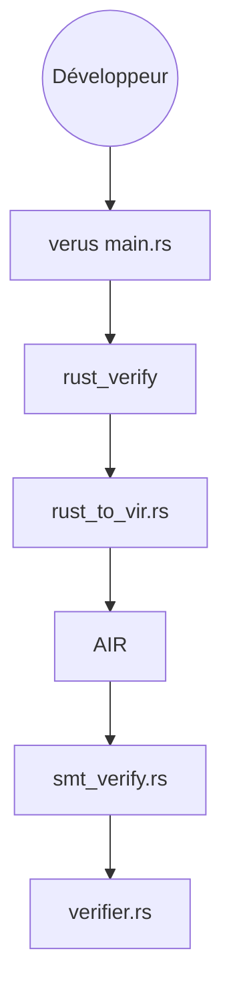

# verus-lang/verus

> Rust code verifier using formal specifications and solvers, with no runtime checks.

## The problem
Testing does not prove that code is correct for all executions; `unsafe` code is particularly risky.

## What it actually does
- You write specifications; Verus statically verifies the Rust code.
- Translates Rust to VIR, then AIR, then queries an SMT solver.
- Supports a subset of Rust and code manipulating raw pointers.
- Provides a standard library of specifications (vstd), macros and a formatter (verusfmt).

## How it is wired

## Trying it
No command in the README: it points to the online Playground and the installation instructions.

## Cost and gotchas
Free. The README warns: active development, missing or broken features, incomplete documentation. 376 open issues.

## What it is not
Not a linter or a test: it requires writing proofs. It only covers a subset of Rust.

## Alternatives
No alternative named in the README.

## For you
Worth watching: fascinating if you write critical Rust, but still young and too costly to learn for everyday data use.
