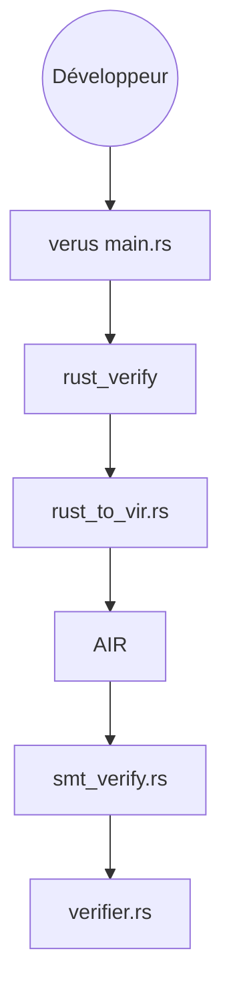

# verus-lang/verus

> Vérificateur de code Rust par spécifications formelles et solveurs, sans contrôles à l'exécution.

## Le problème
Tester ne prouve pas qu'un code est correct pour toutes les exécutions ; le code `unsafe` est particulièrement risqué.

## Ce que ça fait vraiment
- Tu écris des spécifications ; Verus vérifie statiquement le code Rust.
- Traduit Rust vers VIR, puis AIR, puis interroge un solveur SMT.
- Prend en charge un sous-ensemble de Rust et du code manipulant des pointeurs bruts.
- Fournit une bibliothèque standard de spécifications (vstd), des macros et un formateur (verusfmt).

## Comment c'est branché

## Essayer
Aucune commande dans le README : il renvoie au Playground en ligne et aux instructions d'installation.

## Coût et pièges
Gratuit. Le README prévient : développement actif, fonctions manquantes ou cassées, documentation incomplète. 376 tickets ouverts.

## Ce que ce n'est pas
Pas un linter ni un test : il exige de rédiger des preuves. Il ne couvre qu'un sous-ensemble de Rust.

## Alternatives
Aucune alternative nommée dans le README.

## Pour toi
À surveiller : fascinant si tu écris du Rust critique, mais encore jeune et trop coûteux à apprendre pour un usage data courant.

