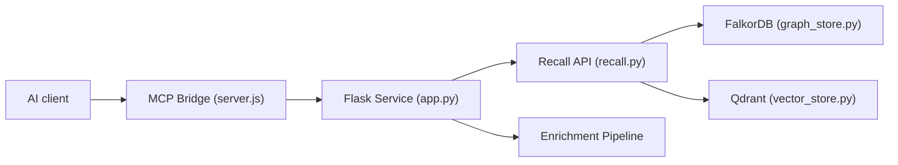

# verygoodplugins/automem

> Long-term memory for AI assistants, based on a graph and vectors, accessible via MCP or REST.

## The problem
An assistant forgets decisions and preferences from one conversation to the next, and vector search alone does not capture the why.

## What it actually does
Flask service that stores memories in FalkorDB (graph, 11 relation types) and Qdrant (embeddings). Recall combines similarity, graph traversal, time, tags and importance. Background enrichment and consolidation. MCP bridge for Claude, Cursor, Codex; remote MCP for ChatGPT. No LLM call during recall, but embeddings (Voyage, OpenAI or local).

## How it is wired


## Trying it
```bash
git clone https://github.com/verygoodplugins/automem.git
cd automem
make dev
npx @verygoodplugins/mcp-automem setup
```

## Cost and gotchas
Two databases to host (FalkorDB, Qdrant); paid embeddings depending on the provider. If FalkorDB goes down, the API returns 503.

## What it is not
Not a stable product: the README lists limitations (tags as a strict filter, imperfect temporal updating). The 57.4% score on BEAM comes from the author.

## Alternatives
No alternative named in the README (it cites HippoRAG 2 and A-MEM as sources of techniques).

## For you
Watch: graph plus vector approach is interesting for agent memory; pre-1.0, so test before storing important context in it.
