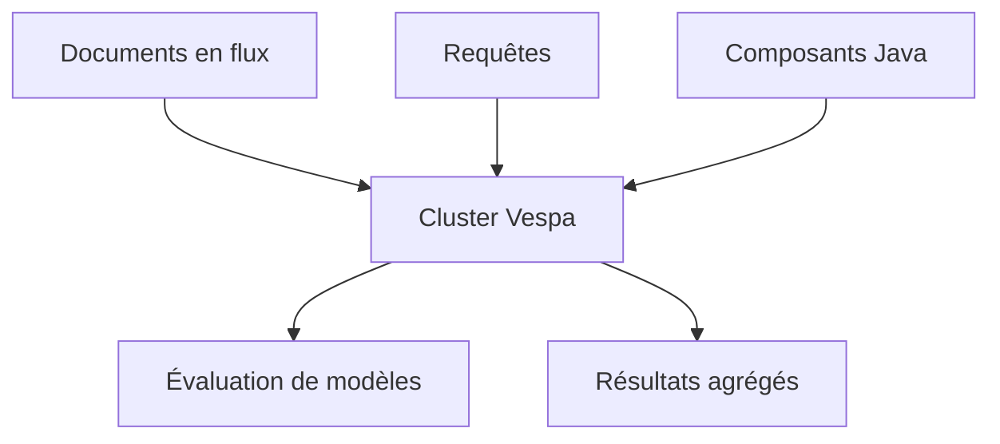

# vespa-engine/vespa

> Search and inference platform over vectors, tensors, text and structured data, at scale.

## The problem
Search, recommendation and personalization require selecting, evaluating models and aggregating in under 100 ms over data that keeps changing.

## What it actually does
A highly available distributed engine: selecting subsets from a large corpus, evaluating trained models on the selected data, organizing and aggregating the results. Java components can be added to the application. The repository contains all the code (C++ and Java) and a release comes out of master every morning from Monday to Thursday.

## How it is wired

Diagram not provided: simplified diagram based on the README.

## Trying it
```bash
# Pour utiliser Vespa : guide https://docs.vespa.ai/en/getting-started.html
# Construire les modules Java :
export MAVEN_OPTS="-Xms128m -Xmx1024m"
./bootstrap.sh java
mvn install --threads 1C
```

## Cost and gotchas
Free when self-hosted; managed cloud offered as an option. C++ and Java builds are supported on AlmaLinux 8.

## What it is not
Not a simple vector database: it is a complete platform to deploy. The README gives no direct start command.

## Alternatives
No alternative is named in the README.

## For you
Adopt it for RAG or recommendation at scale: vector search and inference served together, an old and active industrial project.
