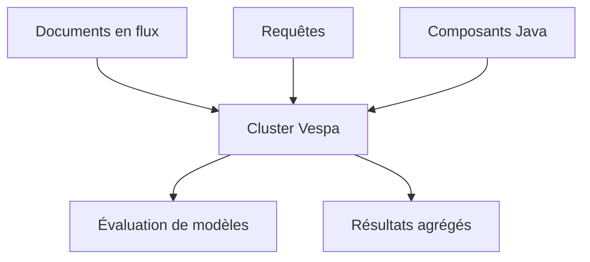

# vespa-engine/vespa

> Plateforme de recherche et d'inférence sur vecteurs, tenseurs, texte et données structurées, à grande échelle.

## Le problème
Recherche, recommandation et personnalisation exigent de sélectionner, évaluer des modèles et agréger en moins de 100 ms sur des données qui changent.

## Ce que ça fait vraiment
Moteur distribué à haute disponibilité : sélection de sous-ensembles dans un grand corpus, évaluation de modèles appris sur les données sélectionnées, organisation et agrégation des résultats. Des composants Java s'ajoutent à l'application. Le dépôt contient tout le code (C++ et Java) et une version sort du master chaque matin du lundi au jeudi.

## Comment c'est branché

Schéma non fourni : diagramme simplifié d'après le README.

## Essayer
```bash
# Pour utiliser Vespa : guide https://docs.vespa.ai/en/getting-started.html
# Construire les modules Java :
export MAVEN_OPTS="-Xms128m -Xmx1024m"
./bootstrap.sh java
mvn install --threads 1C
```

## Coût et pièges
Gratuit en autohébergement ; cloud géré proposé en option. Compilation C++ et Java prise en charge sur AlmaLinux 8.

## Ce que ce n'est pas
Pas une simple base vectorielle : c'est une plateforme complète à déployer. Le README ne donne pas de commande de démarrage directe.

## Alternatives
Aucune alternative nommée dans le README.

## Pour toi
À adopter pour du RAG ou de la recommandation à grande échelle : recherche vectorielle et inférence servies ensemble, projet industriel ancien et actif.

