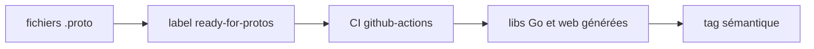

# viamrobotics/api

> Protobuf definitions of Viam's public API, for developers of the robotics platform.

## The problem
Viam's clients and SDKs must share a common API definition.

## What it actually does
Contains the `.proto` files. The Go and web libraries are generated by CI when the `ready-for-protos` label is added. Tools are managed with mise. Versions are imported by semantic tag, never by hash.

## How it is wired


## Trying it
```bash
curl https://mise.run | sh
mise trust
mise tasks
mise r -f buf
```

## Cost and gotchas
Free. Do not modify the generated files; do not move or delete version tags.

## What it is not
Not an SDK or a client: only the definitions. Of no interest without the Viam platform.

## Alternatives
No alternative named in the README.

## For you
Ignore: the API contract of a robotics platform, only useful if you integrate Viam.
