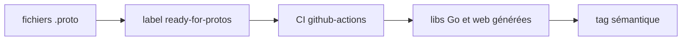

# viamrobotics/api

> Définitions Protobuf de l'API publique de Viam, pour les développeurs de la plateforme robotique.

## Le problème
Les clients et SDK de Viam doivent partager une définition d'API commune.

## Ce que ça fait vraiment
Contient les fichiers `.proto`. Les bibliothèques Go et web sont générées par la CI quand on ajoute le label `ready-for-protos`. Les outils sont gérés avec mise. Les versions s'importent par tag sémantique, jamais par hash.

## Comment c'est branché


## Essayer
```bash
curl https://mise.run | sh
mise trust
mise tasks
mise r -f buf
```

## Coût et pièges
Gratuit. Ne pas modifier les fichiers générés ; ne pas déplacer ni supprimer les tags de version.

## Ce que ce n'est pas
Pas un SDK ni un client : seulement les définitions. Intérêt nul sans la plateforme Viam.

## Alternatives
Aucune alternative nommée dans le README.

## Pour toi
Ignorer : contrat d'API d'une plateforme robotique, utile seulement si tu intègres Viam.

