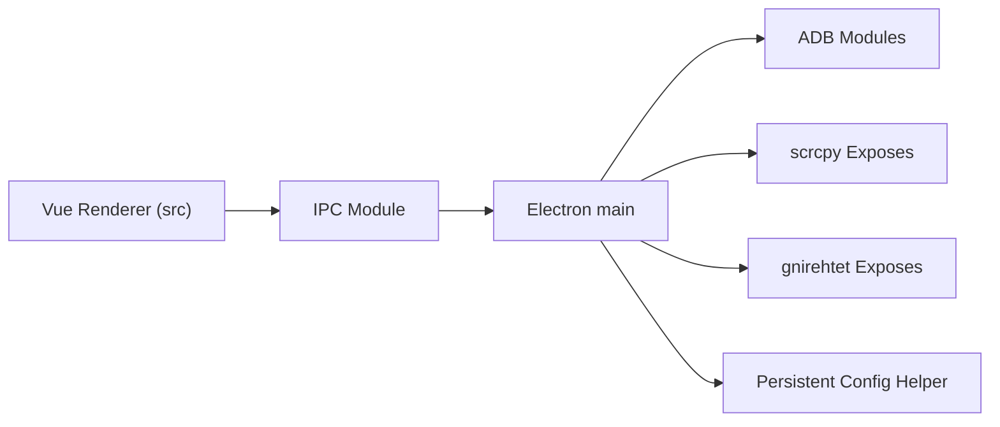

# viarotel-org/escrcpy

> Desktop graphical interface to display and control an Android phone with scrcpy.

## The problem
scrcpy is used from the command line, which makes managing several devices awkward.

## What it actually does
Electron/Vue application: built-in mirror, keyboard mapping, multi-device control, visual automation scripts, wireless ADB connection, an MCP-based "Copilot" assistant. The Electron main process calls adb, scrcpy and gnirehtet through IPC.

## How it is wired

## Trying it
No command: install with the packages from the Releases page, or via Homebrew through the homebrew-escrcpy repository.

## Cost and gotchas
Free, but some advanced features come from a private, paid repository, EscrcpyX. The README warns: limited support, irregular updates.

## What it is not
Not a mobile testing tool for CI, nor a service: it is a local desktop app.

## Alternatives
scrcpy is the base component cited by the README.

## For you
Keep an eye on it: useful for driving Android test devices, but peripheral to data/AI and run by a single person.
