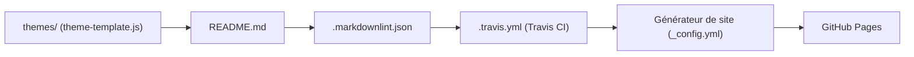

# viatsko/awesome-vscode

> List of extensions, themes and resources for Visual Studio Code, sorted by topic.

## The problem
The VS Code marketplace holds a very large number of extensions, and spotting the good ones by language or use takes time.

## What it actually does
The README sorts extensions into sections: syntax, migration from other editors, lint and IntelliSense by language (including Python, Go, Rust), GitHub, productivity, formatting, themes and resources for extension authors. Some entries carry a deprecation notice. The architecture provided is inferred from the repository (Jekyll, Travis CI) and itself states that no diagram exists in the docs.

## How it is wired

## Trying it
No command documented: the README is the list; contributions go through the repository's guides.

## Cost and gotchas
Free, CC0 license. Part of the entries are dated (Travis CI, TSLint, deprecated extensions); some are commercial (Monokai Pro, VSCode.pro course). Last push on 2026-06-21.

## What it is not
It is not a tested selection: partial upkeep, and nothing is installed by the repository itself.

## Alternatives
No alternative cited in the README.

## For you
Worth watching: a starting point for equipping VS Code for Python or Jupyter, but the official marketplace remains more up to date.
