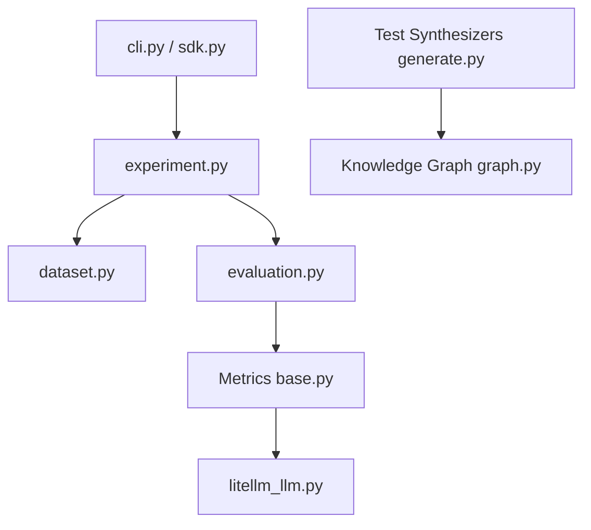

# vibrantlabsai/ragas

> Evaluation library for LLM and RAG applications: metrics, test-set generation, experiments.

## The problem
Judging a RAG or an agent "by eye" allows neither comparing two versions nor spotting regressions.

## What it actually does
LLM-computed metrics and classic metrics, plus custom metrics (`DiscreteMetric`) that return a score and a justification.
It generates test sets from a knowledge graph extracted from the documents.
A `ragas quickstart` CLI creates template projects, for now only `rag_eval`.
It integrates with LangChain and observability tools, with prompt optimizers.

## How it is wired


## Trying it
```bash
pip install ragas
pip install git+https://github.com/vibrantlabsai/ragas
ragas quickstart
ragas quickstart rag_eval
ragas quickstart rag_eval -o ./my-project
```

## Cost and gotchas
Each evaluation calls a judge LLM, which is billed (`OPENAI_API_KEY`). Anonymous telemetry is on by default; turn it off with `RAGAS_DO_NOT_TRACK=true`.

## What it is not
Not a production observability platform. The agent and benchmark templates are not yet available. Last push on 2026-02-24.

## Alternatives
The README names no alternative repository.

## For you
Adopt: it is the open-source reference for evaluating your RAGs. Remember to turn off telemetry and budget for the judge LLM calls.
