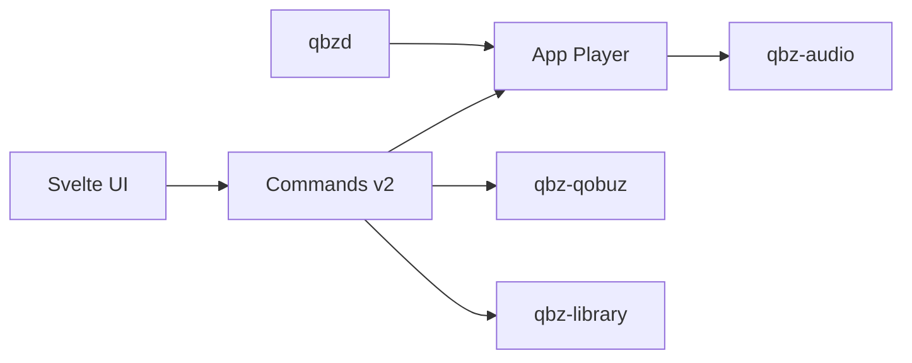

# vicrodh/qbz

> Former Linux desktop client for Qobuz, discontinued by its author after discussions with Qobuz.

## The problem
Linux users had no native Qobuz client with faithful playback and local library management.

## What it actually does
The current README is a closing note: the author shut down the repository and the distribution channels at Qobuz's request and declares the project dead. Judging from the code, it was a Tauri 2 application with a Svelte interface, a Rust audio engine (PipeWire, ALSA, PulseAudio), a local SQLite library, casting and Qobuz Connect.

## How it is wired


## Trying it
```bash
# Aucune commande : le projet est arrêté, le README ne documente pas d'installation.
```

## Cost and gotchas
A paid Qobuz account was required. Distribution has stopped and no license is declared: do not use this code as a base without clarification.

## What it is not
It is not a living project or a reference repository: the author writes that QBZ is dead and that he is not associated with any fork. He announces another project named Chilpa.

## Alternatives
No alternative named in the README.

## For you
Ignore: project abandoned at Qobuz's request, no license, and unrelated to data / AI / MLOps work.
