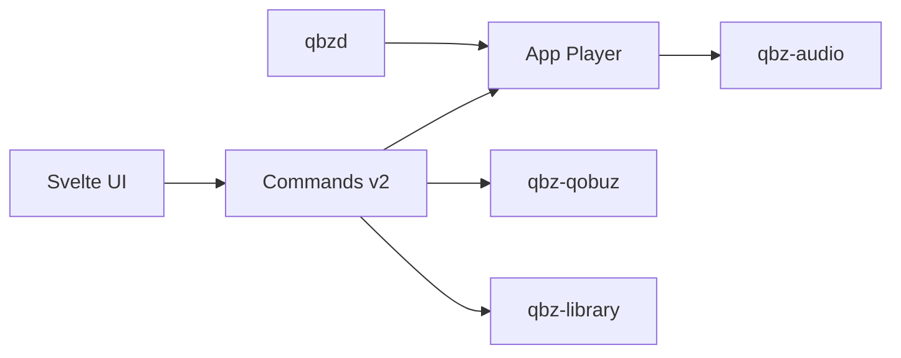

# vicrodh/qbz

> Ancien client de bureau Linux pour Qobuz, arrêté par son auteur après des échanges avec Qobuz.

## Le problème
Les utilisateurs Linux n'avaient pas de client Qobuz natif avec lecture fidèle et gestion de bibliothèque locale.

## Ce que ça fait vraiment
Le README actuel est une note de fin : l'auteur a fermé le dépôt et les canaux de distribution à la demande de Qobuz et déclare le projet mort. D'après le code, c'était une application Tauri 2 avec interface Svelte, un moteur audio Rust (PipeWire, ALSA, PulseAudio), une bibliothèque locale SQLite, du casting et Qobuz Connect.

## Comment c'est branché


## Essayer
```bash
# Aucune commande : le projet est arrêté, le README ne documente pas d'installation.
```

## Coût et pièges
Il fallait un compte Qobuz payant. Distribution arrêtée, aucune licence déclarée : n'utilise pas ce code comme base sans clarification.

## Ce que ce n'est pas
Ce n'est pas un projet vivant ni un dépôt de référence : l'auteur écrit que QBZ est mort et qu'il n'est lié à aucun fork. Il annonce un autre projet nommé Chilpa.

## Alternatives
Aucune alternative nommée dans le README.

## Pour toi
À ignorer : projet abandonné à la demande de Qobuz, sans licence, et sans rapport avec un travail data / IA / MLOps.

