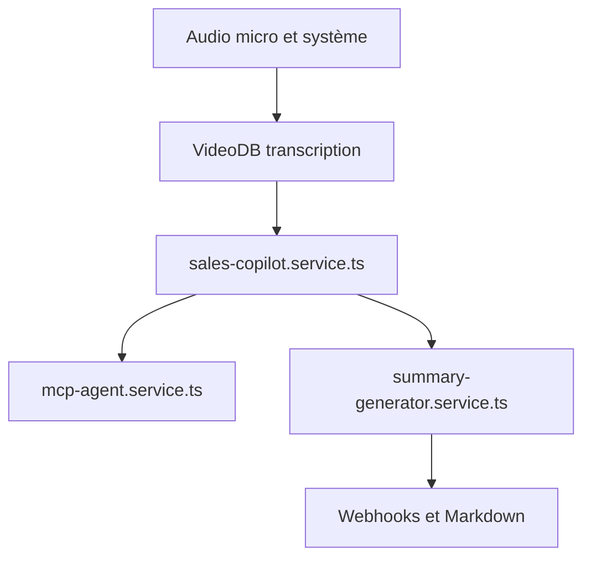

# video-db/call.md

> Desktop application that records, transcribes and analyzes live meetings using VideoDB.

## The problem
Following a meeting, noting actions and looking up information live takes up attention.

## What it actually does
It captures microphone and system audio, transcribes in real time via VideoDB (WebSocket) and produces suggestions and nudges. An MCP agent calls your tools, then a summary (overview, key points, actions) goes out as a Markdown export or n8n and Zapier webhooks.

## How it is wired
Diagram based on the described code structure.



## Trying it
```bash
curl -fsSL https://artifacts.videodb.io/call.md/install | bash
npm install
npm run rebuild
npm run dev
```

## Cost and gotchas
VideoDB API key required; audio and transcripts go to VideoDB. Recording limited to 2 hours, macOS or Windows x64 only.

## What it is not
Not a 100% local tool: transcription and AI go through a third-party service. No recording on Linux. No license declared.

## Alternatives
No alternative named in the README.

## For you
Worth watching: the MCP and copilot architecture is instructive, but your meetings go to a third party and the license is missing.
