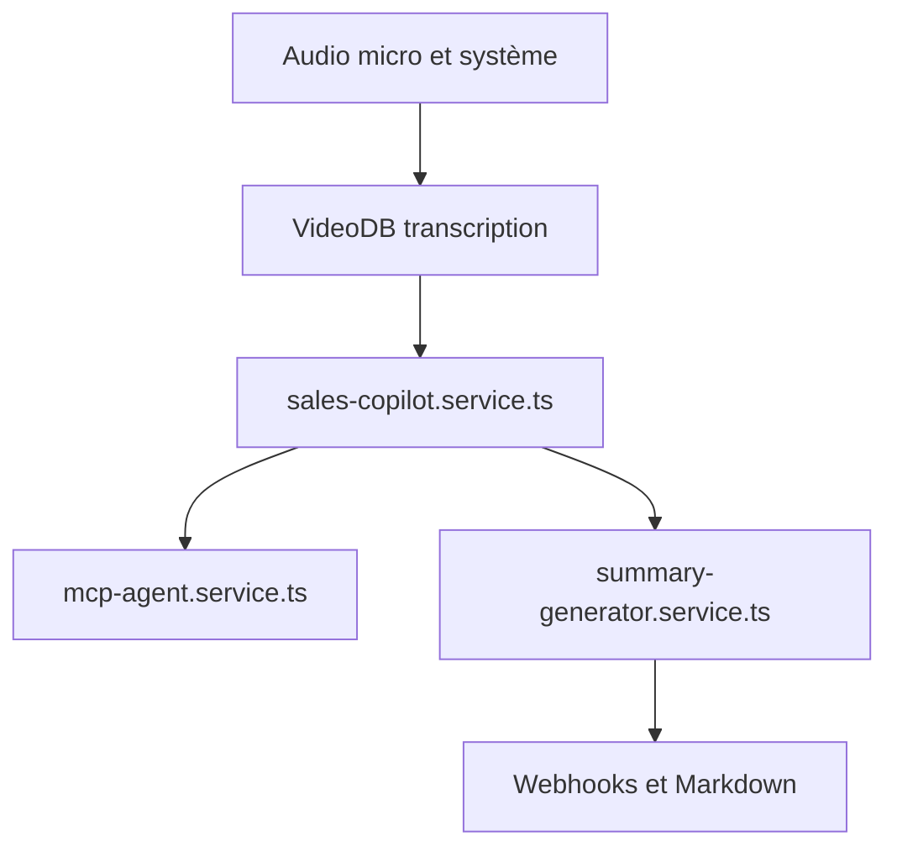

# video-db/call.md

> Application de bureau qui enregistre, transcrit et analyse les réunions en direct grâce à VideoDB.

## Le problème
Suivre une réunion, noter les actions et rechercher des informations en direct mobilise l'attention.

## Ce que ça fait vraiment
Elle capture micro et audio système, transcrit en temps réel via VideoDB (WebSocket) et produit suggestions et nudges. Un agent MCP appelle tes outils, puis un résumé (aperçu, points clés, actions) part en export Markdown ou webhooks n8n et Zapier.

## Comment c'est branché
Schéma d'après la structure du code décrite.



## Essayer
```bash
curl -fsSL https://artifacts.videodb.io/call.md/install | bash
npm install
npm run rebuild
npm run dev
```

## Coût et pièges
Clé API VideoDB nécessaire ; audio et transcriptions partent chez VideoDB. Enregistrement limité à 2 heures, macOS ou Windows x64 uniquement.

## Ce que ce n'est pas
Pas un outil 100 % local : transcription et IA passent par un service tiers. Pas d'enregistrement sous Linux. Aucune licence déclarée.

## Alternatives
Aucune alternative nommée dans le README.

## Pour toi
À surveiller : l'architecture MCP et copilote est instructive, mais tes réunions partent chez un tiers et la licence manque.

