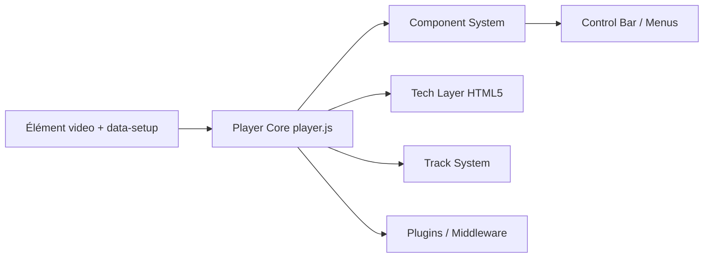

# videojs/video.js

> Open-source video player for browsers, with HLS, DASH and a plugin ecosystem, for web developers.

## The problem
Native HTML5 players vary from one browser to another and cannot play HLS or DASH streams on their own.

## What it actually does
Video.js replaces the `<video>` element with a uniform player: control bar, menus, audio, video and text tracks (subtitles), common web formats, HLS and DASH streaming, plugins. Loaded through a tag with a `data-setup` attribute or through the `videojs('id')` function. According to the architecture: player core, component system, events, HTML5 "tech" layer, interface and tracks.

## How it is wired


## Trying it
```bash
# Aucune commande shell documentée : intégration par balises HTML (CDN vjs.zencdn.net, unpkg, cdnjs) ou npm
```

## Cost and gotchas
Free; the CDN copy is hosted by Fastly. License present but not identified by GitHub: to be checked. The README announces major changes with Video.js 10.

## What it is not
Not a video hosting or transcoding service: it plays existing streams.

## Alternatives
- No alternative named in the README.

## For you
Ignore: a web video player brings nothing to a data/AI/MLOps workflow, and the unidentified license adds doubt.
