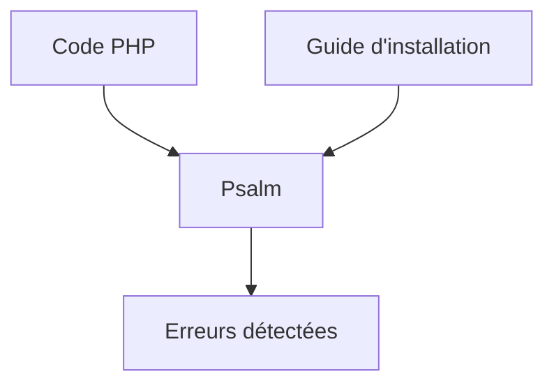

# vimeo/psalm

> Static analysis tool to find errors in PHP applications.

## The problem
Typing and logic errors in PHP only show up at runtime.

## What it actually does
Analyzes PHP code without running it and reports errors. The README does not describe the features: it points to the installation guide, an online demo and the site's documentation. Born at Vimeo, it is maintained by several people.

## How it is wired

Simplified diagram based on the sheet, no diagram provided.

## Trying it
```bash
# Aucune commande dans le README : voir le guide d'installation du site de Psalm.
```

## Cost and gotchas
Free. 2,316 open issues, heavy maintenance load. The installation method is not given here.

## What it is not
Not a general-purpose tool: it targets PHP only. The README does not document the rules or performance.

## Alternatives
No alternative named in the README.

## For you
Ignore: PHP analyzer with no use in a data, AI or MLOps profile.
