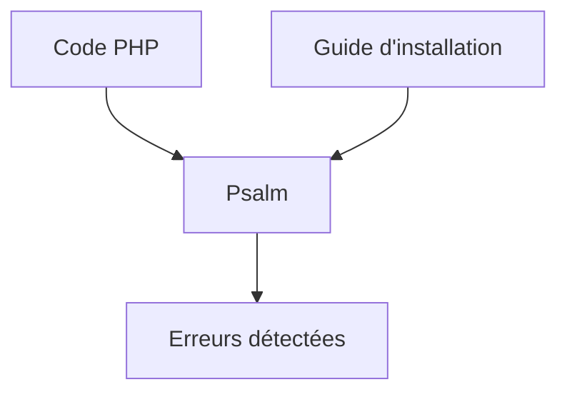

# vimeo/psalm

> Outil d'analyse statique pour trouver des erreurs dans les applications PHP.

## Le problème
Les erreurs de typage et de logique en PHP ne se voient qu'à l'exécution.

## Ce que ça fait vraiment
Analyse le code PHP sans l'exécuter et signale les erreurs. Le README ne décrit pas les fonctions : il renvoie vers le guide d'installation, une démo en ligne et la documentation du site. Né chez Vimeo, il est maintenu par plusieurs personnes.

## Comment c'est branché

Schéma simplifié d'après la fiche, sans diagramme fourni.

## Essayer
```bash
# Aucune commande dans le README : voir le guide d'installation du site de Psalm.
```

## Coût et pièges
Gratuit. 2 316 issues ouvertes, charge de maintenance importante. Le mode d'installation n'est pas indiqué ici.

## Ce que ce n'est pas
Pas un outil généraliste : il ne vise que PHP. Le README ne documente pas les règles ni les performances.

## Alternatives
Aucune alternative nommée dans le README.

## Pour toi
À ignorer : analyseur PHP sans usage dans un profil data, IA ou MLOps.

