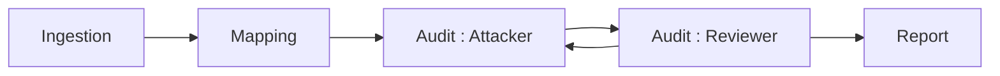

# vinceAmstoutz/symfony-security-auditor

> Auditeur de sécurité Symfony à agents LLM : un attaquant et un relecteur cherchent les failles logiques.

## Le problème
Les analyseurs statiques et scanners de dépendances ne voient pas les failles de logique métier ni les contrôles d'accès manquants.

## Ce que ça fait vraiment
Un agent attaquant cherche des failles, un relecteur sceptique écarte les faux positifs sur trois itérations, puis un rapport sort en console, JSON, SARIF, HTML ou Markdown. Un pré-scan sans jeton marque les zones à risque, les secrets sont masqués avant l'envoi au LLM, et un mode diff n'audite que les fichiers modifiés. Fonctionne aussi comme serveur MCP (expérimental).

## Comment c'est branché


## Essayer
```bash
curl -fsSL https://raw.githubusercontent.com/vinceAmstoutz/symfony-security-auditor/main/install.sh | sh
symfony-security-auditor init
symfony-security-auditor audit /path/to/your/symfony/project
bin/console audit:run --dry-run
```

## Coût et pièges
Clé d'API d'un fournisseur LLM à ta charge (environ 0,50 $ par audit nocturne d'une appli moyenne selon l'auteur), ou Ollama local sans clé. `init` demande PHP et Composer. Les rapports listent tes failles : ne pas les publier en artefact CI public.

## Ce que ce n'est pas
Un outil défensif d'audit de son propre code, pas un scanner d'intrusion. Il ne remplace ni PHPStan ni Dependabot. Il ne vise que Symfony.

## Alternatives
- PHPStan et Psalm : erreurs de types, sans LLM.
- Dependabot, Renovate, Snyk : CVE des dépendances.

## Pour toi
Surveiller : exemple utile de boucle attaquant/relecteur avec coût mesurable (`--dry-run`), mais utile seulement si tu audites du Symfony.

