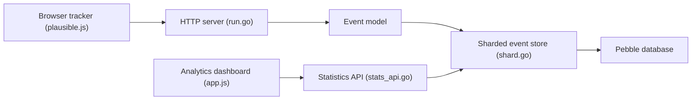

# vinceanalytics/vince

> Self-hosted alternative to Google Analytics, in a single Go binary, compatible with Plausible scripts.

## The problem
Measure a site's audience without cookies or sending data to Google, and without stacking Elixir, ClickHouse and PostgreSQL like Plausible.

## What it actually does
Receives events from a tracking script, stores them in a Pebble database in shards, and serves a dashboard and a statistics API (aggregates, breakdowns, time series, current visitors). Tracks outbound links, downloads, 404 pages and custom events; automatic Let's Encrypt TLS, public dashboards or ones shared with a password. Unlimited sites and events; no multi-tenancy or funnels.

## How it is wired


## Trying it
```bash
curl -fsSL https://vinceanalytics.com/install.sh | bash
vince admin --name acme --password 1234
vince serve
docker pull ghcr.io/vinceanalytics/vince
```

## Cost and gotchas
Free; you host and back up yourself. Last push in September 2025. The README example uses a trivial password, to be changed. AGPL-3.0: obligations if a modified version is offered as a network service.

## What it is not
Not a full equivalent of Plausible (the README table lists what is missing). Not a hosted service.

## Alternatives
- Plausible Analytics (cited): more complete, with multi-tenancy and funnels, but more dependencies.

## For you
Worth watching: handy for measuring the usage of a demo or documentation, but little activity for a year; compare with Plausible before committing.
