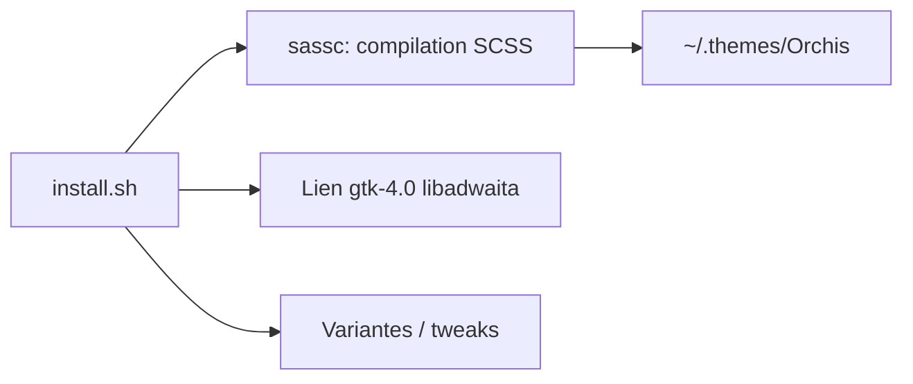

# vinceliuice/Orchis-theme

> Material Design theme for GNOME and GTK environments.

## The problem
Giving a GNOME/GTK desktop a consistent Material Design look.

## What it actually does
An `install.sh` script that builds and installs the theme with color variants, size variants (standard/compact), Activities button icon variants, corner radius and "tweaks" (solid, black, macos, nord, dracula, dock). The `-l` option links the libadwaita theme. Based on materia-theme. Requires GTK ≥ 3.20, gnome-themes-extra, the Murrine engine, sassc.

## How it is wired


## Trying it
```sh
./install.sh
./install.sh -c dark -t purple -l
sudo flatpak override --filesystem=xdg-config/gtk-3.0 && sudo flatpak override --filesystem=xdg-config/gtk-4.0
```

## Cost and gotchas
Free. The libadwaita link no longer goes through Gnome-tweaks. Murrine engine dependencies vary by distribution.

## What it is not
Not a theme for KDE or Windows. GPL-3.0 license.

## Alternatives
No alternative named (nana-4 materia-theme is cited as a base).

## For you
Ignore: Linux desktop cosmetics, unrelated to your data/AI work.
