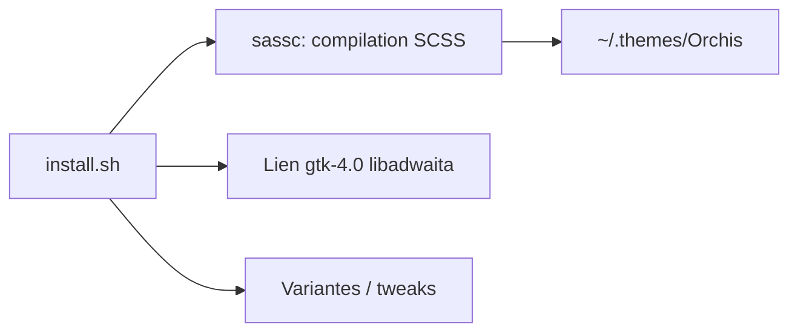

# vinceliuice/Orchis-theme

> Thème Material Design pour GNOME et environnements GTK.

## Le problème
Donner un aspect Material Design cohérent à un bureau GNOME/GTK.

## Ce que ça fait vraiment
Script `install.sh` qui compile et installe le thème avec variantes de couleur, de taille (standard/compact), d'icônes du bouton Activités, de rayon de coins et « tweaks » (solid, black, macos, nord, dracula, dock). Option `-l` pour lier le thème libadwaita. Basé sur materia-theme. Requiert GTK ≥ 3.20, gnome-themes-extra, moteur Murrine, sassc.

## Comment c'est branché


## Essayer
```sh
./install.sh
./install.sh -c dark -t purple -l
sudo flatpak override --filesystem=xdg-config/gtk-3.0 && sudo flatpak override --filesystem=xdg-config/gtk-4.0
```

## Coût et pièges
Gratuit. Le lien libadwaita ne passe plus par Gnome-tweaks. Dépendances de moteur Murrine selon la distribution.

## Ce que ce n'est pas
Pas un thème pour KDE ni Windows. Licence GPL-3.0.

## Alternatives
Aucune alternative nommée (nana-4 materia-theme est cité comme base).

## Pour toi
Ignorer : cosmétique de bureau Linux, sans rapport avec ton travail data/IA.

