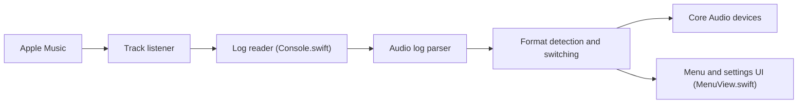

# vincentneo/LosslessSwitcher

> macOS menu bar application that sets the sample rate according to the Apple Music track.

## The problem
On macOS, Apple Music does not automatically change the audio output's sample rate; you have to do it by hand through Audio MIDI Setup.

## What it actually does
Reads the macOS system logs to learn the format of the current track, picks a format supported by the output device and applies it through Core Audio. Shows the sample rate in the menu bar; bit depth is optional but reduces reliability, and a user script can be triggered. Brief playback interruptions are possible.

## How it is wired

## Trying it
No documented command: download the `.zip` of the desired version and drag the app into Applications.

## Cost and gotchas
Free. Not sandboxed; the user must be an administrator; frequent log reading can speed up battery wear on a laptop. Version 2.0 for macOS Sequoia 15.4+ is still in beta according to the README.

## What it is not
Not an audio player or a converter: it only changes the device's sample rate. Only works with Apple Music.

## Alternatives
No alternative named in the README.

## For you
Ignore: a comfort audio utility for Mac, unrelated to data, AI or MLOps.
