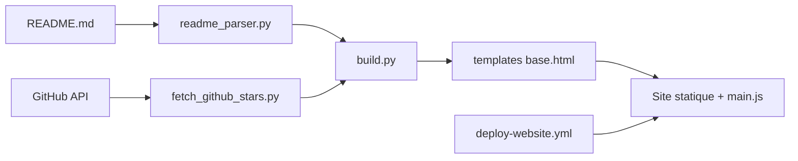

# vinta/awesome-python

> A categorized and annotated list of Python libraries and tools, organized by domain, for those seeking a specific component.

## The problem
Finding the right Python library for a specific need (ORM, web scraping, LLM service, testing) often requires sifting through a variety of search results, which can be inconsistent and sometimes outdated.

## What it actually does
A single `README.md` file contains the list: approximately one hundred categories (AI & ML, Web, Data & Science, DevOps, security, etc.), with one line per project. The selection is presented as "opinionated."

`website/readme_parser.py` converts this Markdown into structured data, `website/fetch_github_stars.py` adds the stars using the GitHub API, and then `website/build.py` generates a static website where you can search and filter (using `main.js`), along with a `llms.txt` page.

Two GitHub Actions workflows: validation (`ci.yml`) and website deployment (`deploy-website.yml`).

## How it is wired

## Trying it
There are no documented commands in the README: either you read the list, or the site generates them.

## Cost and gotchas
No fees or installation required to read. License is present but not identified by GitHub: this should be verified before reusing the content.

## What it is not
This is not a comparative analysis: there are no measurements, a single description per project, often taken directly from the project's own description. It is neither exhaustive nor neutral, as the selection is presented as subjective.

## Alternatives
- awesome-deep-learning — the README provides further information on deep learning.
- awesome-machine-learning — the README file provides further information on machine learning.

## For you
Things to keep in mind: the AI & ML section (vllm, peft, dspy, LiteLLM, instructor) provides a quick starting point.
