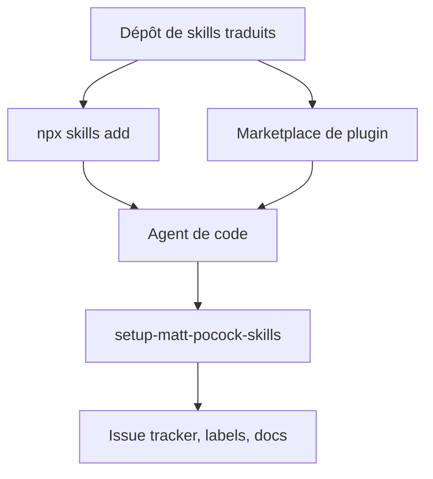

# vinvcn/mattpocock-skills-zh-CN

> Chinese translation of Matt Pocock's agent skills, for developers who read Chinese.

## The problem
Matt Pocock's agent skills are in English, which slows their adoption for a Chinese-speaking audience.

## What it actually does
Repository of translated skills (grill-me, grill-with-docs, tdd, diagnosing-bugs, to-spec, triage, handoff, etc.) installable via `npx skills`, a Claude Code plugin marketplace, Codex, Copilot or Gemini CLI. A `/setup-matt-pocock-skills` skill configures issue tracking, labels and the docs folder. An installation path specific to this fork exists for DeepSeek Harness. Skills are invoked with the `/zh-` prefix.

## How it is wired
Simplified diagram based on the fiche, no diagram provided.


## Trying it
```bash
npx skills@latest add vinvcn/mattpocock-skills-zh-CN
claude plugin marketplace add vinvcn/mattpocock-skills-zh-CN
claude plugin install mattpocock-skills@mattpocock
```

## Cost and gotchas
Free. Choose a single path per agent (skills.sh or plugin), otherwise each skill is installed twice. Updates follow upstream with a delay.

## What it is not
It is not the original: it is a translation maintained by a third party, and the README mixes translated text and notes specific to the fork. The skills do not replace human review.

## Alternatives
- The English upstream, installable via `mattpocock-skills@claude-plugins-official`: reference text, updated first.

## For you
Worth watching: the method (grilling, TDD, shared language) is worth a look, but read the English version rather than this one unless you need the translation.
