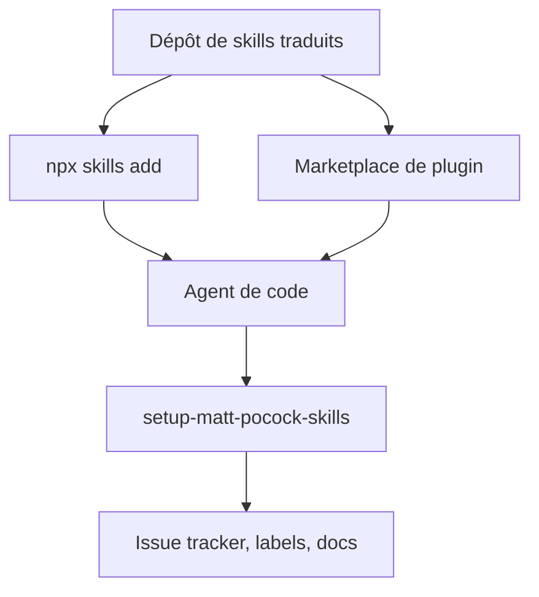

# vinvcn/mattpocock-skills-zh-CN

> Traduction chinoise des skills d'agents de Matt Pocock, pour développeurs qui lisent le chinois.

## Le problème
Les skills d'agents de Matt Pocock sont en anglais, ce qui freine leur adoption pour un public sinophone.

## Ce que ça fait vraiment
Dépôt de skills traduits (grill-me, grill-with-docs, tdd, diagnosing-bugs, to-spec, triage, handoff, etc.) installables via `npx skills`, un marketplace de plugin Claude Code, Codex, Copilot ou Gemini CLI. Un skill `/setup-matt-pocock-skills` configure le suivi d'issues, les labels et le dossier de docs. Une voie d'installation propre à ce fork existe pour DeepSeek Harness. Les skills s'invoquent avec le préfixe `/zh-`.

## Comment c'est branché
Schéma simplifié d'après la fiche, sans diagramme fourni.


## Essayer
```bash
npx skills@latest add vinvcn/mattpocock-skills-zh-CN
claude plugin marketplace add vinvcn/mattpocock-skills-zh-CN
claude plugin install mattpocock-skills@mattpocock
```

## Coût et pièges
Gratuit. Choisir une seule voie par agent (skills.sh ou plugin), sinon chaque skill est installé deux fois. Les mises à jour suivent l'amont avec retard.

## Ce que ce n'est pas
Ce n'est pas l'original : c'est une traduction maintenue par un tiers, et le README mêle texte traduit et notes propres au fork. Les skills ne remplacent pas une revue humaine.

## Alternatives
- L'amont en anglais, installable via `mattpocock-skills@claude-plugins-official` : texte de référence, mis à jour en premier.

## Pour toi
À surveiller : la méthode (grilling, TDD, langage partagé) vaut le détour, mais lis plutôt la version anglaise sauf besoin de la traduction.

