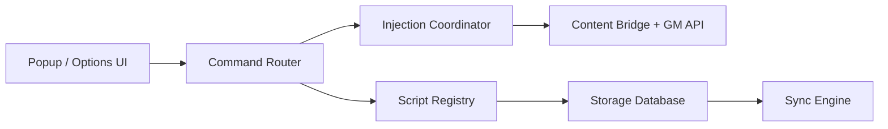

# violentmonkey/violentmonkey

> Browser extension to install and run user scripts on web pages.

## The problem
Adapting the behavior of websites (interface, data, light automation) without waiting for their publishers requires injecting code into pages.

## What it actually does
A WebExtension that installs, stores, updates, synchronizes and runs user scripts. A background command router, an injection coordinator and a content bridge provide the `GM_*` APIs. Synchronization via Dropbox, GitHub, Google Drive, OneDrive, WebDAV or S3.

## How it is wired


## Trying it
```sh
pnpm ci
pnpm dev
pnpm run ci
pnpm build
```

## Cost and gotchas
Free. Trial versions are potentially unstable: export your settings beforehand. A user script runs with access to the pages you visit: only install code you have read.

## What it is not
It is not a script store or a scraping tool: it only provides execution.

## Alternatives
No alternative named in the README.

## For you
Ignore for your work: a simple browsing convenience, with no direct link to data or AI.
