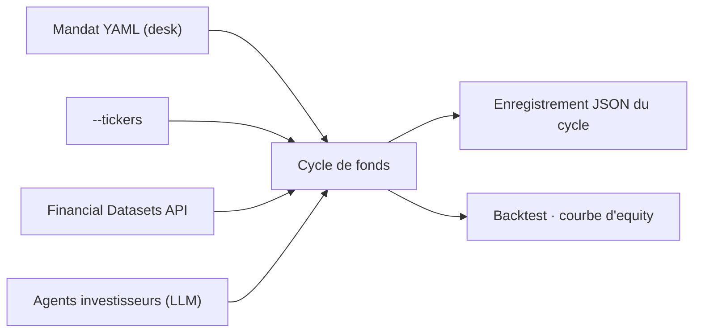

# virattt/ai-hedge-fund

> Proof of concept of a fund driven by LLM agents, for educational purposes.

## The problem
Understanding how LLM agents combine strategies, risk and rebalancing cadence requires a complete sandbox.

## What it actually does
An interactive terminal application to build a "fund" — securities, strategies, rebalancing cadence — then backtest it with its equity curve against a benchmark. Funds are saved as mandate files in `~/.hedge-fund/mandates/`. A mandate describes the desk (strategies, staff, risk, capital, cadence) and never names a ticker: `--tickers` supplies them at run time. In non-interactive mode, the full cycle is output as JSON on stdout. The project is being reworked into a persistent fund with investor agents turned into pluggable "alpha models".

## How it is wired


## Trying it
```bash
pipx install aihf
aihf
aihf ~/.hedge-fund/mandates/example.yaml --tickers AAPL,MSFT --backtest
```

## Cost and gotchas
Two keys required: Financial Datasets (prices, fundamentals, earnings) and a model provider among Anthropic, OpenAI, DeepSeek, Google, xAI, Kimi, TypeSafe. Keys are saved in `~/.hedge-fund/.env`.

## What it is not
The README is explicit: educational and research use only, no real trades are placed, no investment advice, no guarantee, and the creator disclaims any financial responsibility. The project is being reworked: the API may change.

## Alternatives
No alternative named in the README.

## For you
Worth watching: good ground to observe multi-agent orchestration with backtesting, never to be mistaken for a management tool.
