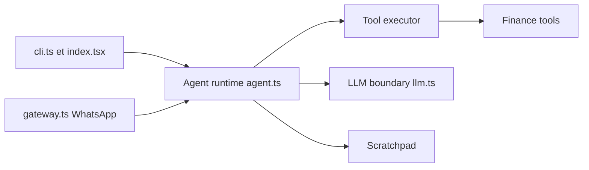

# virattt/dexter

> Autonomous financial research agent in the terminal, which plans, queries market data and checks its own work.

## The problem
A complex financial question requires cross-referencing financial statements, news and figures, and redoing the reasoning by hand.

## What it actually does
Breaks a question into steps, calls tools (financial data, web search, files, browser, memory) and verifies its work with loop and step limits. TUI interface, WhatsApp gateway, cron tasks and an evaluation suite (LangSmith, LLM judge). A log of every call in `.dexter/scratchpad/`. Several LLM providers, including local Ollama.

## How it is wired


## Trying it
```bash
git clone https://github.com/virattt/dexter.git
cd dexter
bun install
cp env.example .env
bun start
```

## Cost and gotchas
OpenAI key and Financial Datasets key (paid depending on usage); Exa optional. Bun >= 1.0 required. No license declared: reuse rights are undefined.

## What it is not
Not a trading tool nor financial advice: the README states educational use, with results that may be wrong. Quality depends on the provider's data.

## Alternatives
No alternative named in the README.

## For you
Keep an eye on it: a good example of a tool-using agent for finance and ready to be read as a reference, but the lack of a license and the dependency on a paid API rule out reusing it as is.
