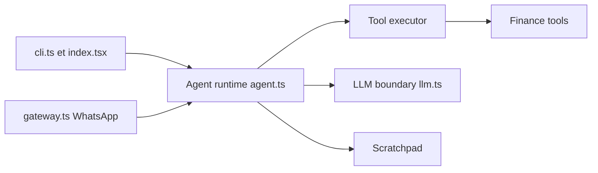

# virattt/dexter

> Agent autonome de recherche financière en terminal, qui planifie, interroge des données de marché et s'auto-vérifie.

## Le problème
Une question financière complexe demande de croiser états financiers, actualités et chiffres, et de refaire le raisonnement à la main.

## Ce que ça fait vraiment
Décompose une question en étapes, appelle des outils (données financières, recherche web, fichiers, navigateur, mémoire) et vérifie son travail avec limites de boucle et d'étapes. Interface TUI, passerelle WhatsApp, tâches cron et suite d'évaluation (LangSmith, LLM juge). Journal de chaque appel dans `.dexter/scratchpad/`. Plusieurs fournisseurs LLM, dont Ollama local.

## Comment c'est branché


## Essayer
```bash
git clone https://github.com/virattt/dexter.git
cd dexter
bun install
cp env.example .env
bun start
```

## Coût et pièges
Clé OpenAI et clé Financial Datasets (payantes selon l'usage) ; Exa optionnel. Bun ≥ 1.0 requis. Aucune licence déclarée : droits de réutilisation non définis.

## Ce que ce n'est pas
Pas un outil de trading ni un conseil financier : le README précise usage éducatif, résultats pouvant être faux. La qualité dépend des données du fournisseur.

## Alternatives
Aucune alternative nommée dans le README.

## Pour toi
À surveiller : bon exemple d'agent à outils pour la finance et prêt à être lu comme référence, mais l'absence de licence et la dépendance à une API payante interdisent de le réutiliser tel quel.

