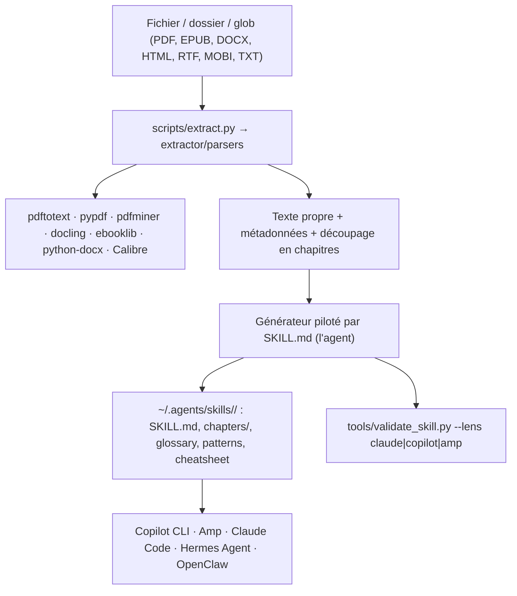

# virgiliojr94/book-to-skill

> Converter that turns a technical book or a docs folder into a queryable Agent Skill.

## The problem
A technical book read once is forgotten three months later, and searching for it in the PDF returns pages, not answers.
Dumping the whole PDF into the agent's context is expensive on every question.

## What it actually does
A deterministic Python extractor turns the document into clean text plus metadata, then a spec-driven generator turns it into a skill tree.
The result: a `SKILL.md` (~4,000 tokens) with mental models and the index, one file per chapter loaded on demand (~1,000 tokens), plus glossary, patterns and cheatsheet.
Chapter files only count toward the budget if the question concerns that chapter.
The repository claims 24×–51× fewer tokens than dumping the book into context, with the methodology in `docs/performance.md`.

## How it is wired


## Trying it
```bash
# Installation via le CLI cross-agent
npx skills add virgiliojr94/book-to-skill

# Ou à la main
git clone https://github.com/virgiliojr94/book-to-skill.git ~/.claude/skills/book-to-skill

# Vérifier quels extracteurs sont présents
python3 scripts/extract.py --check

# PDF scanné : OCR d'abord
ocrmypdf input.pdf output.pdf
```

## Cost and gotchas
Free on the tool side, but the conversion is done by your agent: it is your model quota that pays for the structured extraction, once per book.
`docling` (recommended for technical books) runs at ~1.5 s per page, and a scanned PDF without a text layer is rejected outright.

## What it is not
Not a PDF reader nor a RAG engine: nothing is vector-indexed, the agent reads markdown files.
Not a summary — and deliberately not a reproduction: the generated skill does not copy passages, which limits literal quotations.
Not shareable: the README reminds that publishing the skill of a copyrighted book may infringe those rights.

## Alternatives
No competing repository is named in the README.

## For you
Interesting for folding your internal docs or a pile of papers into a queryable skill; the 24×–51× claim remains to be verified on your own corpus.
