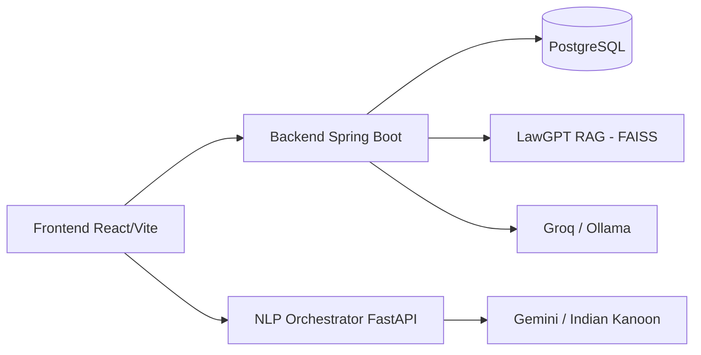

# viru0909-dev/nyay-setu-working

> Indian judicial platform with an AI legal assistant, case management and virtual hearings.

## The problem
Millions of pending cases in India, with citizens lacking a lawyer: the README aims to equip the whole judicial pipeline.

## What it actually does
Monorepo: React/Vite front end, Spring Boot backend (JWT, cases, SHA-256 evidence vault, PostgreSQL), `nlp-orchestrator` FastAPI (deep search over SSE, Groq, Gemini, Indian Kanoon), `lawgpt-service` RAG service (FAISS), Bhashini translation, WebRTC signaling and a RabbitMQ/FFmpeg media pipeline.

## How it is wired


## Trying it
```bash
cd frontend/nyaysetu-frontend && npm install && npm run dev
cd backend/nyaysetu-backend && mvn spring-boot:run
cd nlp-orchestrator && pip install -r requirements.txt && python main.py
```

## Cost and gotchas
Groq and Gemini keys, PostgreSQL 15+, Java 17, Node 20+, Python 3.12+. License present but unidentified: to be verified. 583 open issues.

## What it is not
Not validated legal advice; the README cites no evaluation of the assistant. The README mixes several documents (incomplete media pipeline) and the prerequisite versions diverge.

## Alternatives
None named in the README.

## For you
Watch: the RAG (FAISS) and SSE search assembly is instructive to read, but it is a young project, with a single author, an unclear license and not evaluated.
